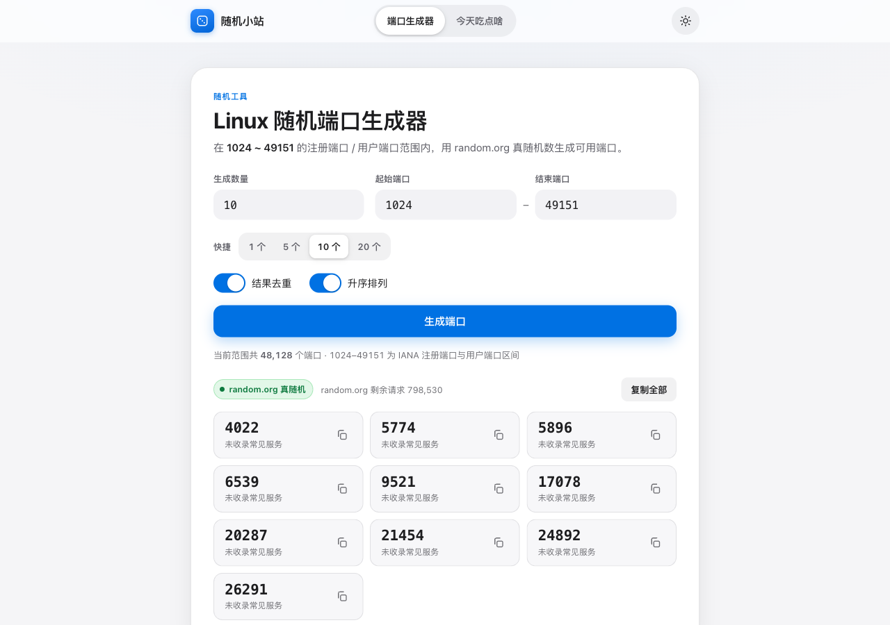

# 随机小站 · random-vue

一个基于 [random.org](https://www.random.org/) 真随机数的 Vue 单页应用，可直接部署到 **Cloudflare Pages**。
包含两个小功能：

1. **Linux 端口生成器** —— 在 `1024 ~ 49151`（IANA 注册端口 / 用户端口）范围内随机生成可用端口，支持去重、排序、一键复制，并标注命中的常见服务（如 3306 MySQL、6379 Redis）。
2. **今天吃点啥** —— 选择困难症救星，按菜系分类随机抽取菜品，支持“不重复”模式，把决定权交给真随机数。

> 随机数由 random.org 提供，前端不直接调用（避免 API Key 泄露与跨域问题），而是通过 **Cloudflare Pages Functions** 在服务端代理请求。



| 今天吃点啥 | 暗色模式 |
| --- | --- |
|  |  |

---

## ✨ 特性

- **Vue 3 + Vite + TypeScript**，纯前端 + 单个 Serverless 函数，零数据库、零长期运行服务器。
- **一键部署 Cloudflare Pages**：静态资源走 CDN，`/api/random` 由 Pages Functions 运行在 Cloudflare 边缘网络。
- **真正的 random.org 真随机数**：通过官方 JSON-RPC API（`generateIntegers`）获取。
- **渐进降级、永不白屏**：
  1. 配置了 `RANDOM_ORG_API_KEY` → 官方 JSON-RPC API（推荐，配额独立）；
  2. 未配置时 → 官方公共测试 Key；
  3. 若官方 API 不可用 → `www.random.org/integers` 公开接口；
  4. 全部失败 → 运行环境（Cloudflare 边缘 / 本地 Node）的 `crypto.getRandomValues`，并在界面明确标注「本地降级随机」。
- **对限流更友好**：对 `429 / 5xx` 做有限次退避重试；单次最多生成 100 个整数。
- **细节体验**：响应式布局、亮/暗主题（记忆偏好）、复制反馈、来源与剩余配额展示、常见端口识别。
- **Apple 风格设计系统（Tailwind CSS v4）**：克制的中性色 + 单一系统蓝强调色、半透明材质顶栏、带弹簧动效的分段控件（可中断、尊重 `prefers-reduced-motion`）、iOS 开关与清晰的信息层级。整套样式由 Tailwind v4 驱动：`@theme` 设计令牌 + `@layer components` 语义原语。

---

## 🧱 技术栈

| 层 | 选型 |
| --- | --- |
| 前端框架 | Vue 3（`<script setup>` + TypeScript） |
| 样式 | Tailwind CSS v4（`@theme` 设计令牌 + `@layer components` 原语） |
| 构建工具 | Vite（`@tailwindcss/vite` 插件） |
| 部署平台 | Cloudflare Pages |
| 服务端 | Cloudflare Pages Functions（Workers 运行时） |
| 随机源 | random.org JSON-RPC API / 公开接口 |

---

## 📁 目录结构

```
random-vue/
├── functions/
│   └── api/random.ts        # Cloudflare Pages Function：/api/random 代理
├── shared/
│   └── random.ts            # 与 random.org 交互的核心逻辑（前端 dev 与生产共用）
├── src/
│   ├── components/
│   │   ├── PortGenerator.vue
│   │   └── FoodPicker.vue
│   ├── composables/useRandom.ts
│   ├── data/
│   │   ├── knownPorts.ts    # 常见端口 → 服务名
│   │   └── foods.ts         # 菜品数据
│   ├── App.vue
│   ├── main.ts
│   └── style.css            # Tailwind 入口：@theme 令牌 / 组件原语 / 动画 / 无障碍
├── tests/random.test.ts     # bun test 单元测试
├── index.html
├── vite.config.ts           # 含 dev 环境的 /api/random 中间件
├── wrangler.toml            # Cloudflare Pages 配置
└── .dev.vars.example        # 本地环境变量示例
```

---

## 🎨 样式系统（Tailwind CSS v4）

样式已从手写 CSS 迁移到 **Tailwind CSS v4**，但保留原有的 Apple 设计语言。结构分三层：

1. **设计令牌（`@theme`）**：`src/style.css` 的 `:root` / `[data-theme='dark']` 集中定义颜色、
   圆角、阴影、缓动等 CSS 变量，再用 `@theme inline` 映射为语义工具类
   （`bg-canvas`、`text-ink`、`border-line`、`shadow-card`…）。映射的是运行时变量，
   因此亮/暗主题可随 `<html data-theme>` 即时切换，无需成对编写 `dark:` 变体。
2. **组件原语（`@layer components`）**：面板、按钮、输入框、iOS 开关、分段控件、状态徽章等
   可复用部件用 `@apply` 组合工具类，保证设计系统级的一致性与可读性。
3. **基础层与无障碍**：`@layer base` 负责排版 / 链接 / 焦点环；文件末尾的媒体查询负责
   `prefers-reduced-motion` / `prefers-reduced-transparency` / `prefers-contrast` 降级。

组件模板（`App.vue` / `PortGenerator.vue` / `FoodPicker.vue`）继续使用这些语义类名，
并配合 Tailwind 工具类描述布局；主题切换仍由 `App.vue` 通过 `<html data-theme>` 完成。

---

## 🚀 本地开发

环境要求：**Bun**（本项目使用 Bun，你也可以改用 Node.js 20+ 与对应包管理器）。

```bash
bun install
bun run dev
# 打开 http://localhost:5173
```

`vite.config.ts` 内置了一个开发中间件，会在本地把 `/api/random` 转发到真正的 random.org，
因此无需先启动 wrangler 也能完整体验。

如需使用你自己的 random.org API Key：

```bash
cp .dev.vars.example .dev.vars
# 编辑 .dev.vars 填入 RANDOM_ORG_API_KEY=你的key
```

---

## 🔌 /api/random 接口

由 `functions/api/random.ts` 提供，GET 请求：

| 参数 | 说明 | 默认 |
| --- | --- | --- |
| `n` | 生成数量，1 ~ 100 | `1` |
| `min` | 最小值（含） | `1024` |
| `max` | 最大值（含） | `49151` |
| `unique` | 是否去重：`1` / `true` | 否 |

示例：

```bash
curl "https://your-project.pages.dev/api/random?n=5&min=1024&max=49151&unique=1"
```

成功响应：

```json
{
  "ok": true,
  "numbers": [12815, 13672, 23151, 24835, 41099],
  "source": "random.org",
  "transport": "json-rpc",
  "quota": { "bitsLeft": 3979669, "requestsLeft": 799154 }
}
```

降级响应（random.org 不可用时）：

```json
{
  "ok": true,
  "numbers": [3306],
  "source": "local",
  "transport": "local",
  "reason": "random.org 暂不可用：..."
}
```

---

## ☁️ 部署到 Cloudflare Pages

### 方式 A：Wrangler CLI（推荐）

```bash
# 1) 登录 Cloudflare（或改用 CLOUDFLARE_API_TOKEN 环境变量）
bunx wrangler login

# 2) 首次创建 Pages 项目（项目名可自定义，与 wrangler.toml 中 name 保持一致）
bunx wrangler pages project create random-vue

# 3) （可选，强烈推荐）配置自己的 random.org API Key
bunx wrangler pages secret put RANDOM_ORG_API_KEY --project-name random-vue

# 4) 构建并部署
bun run deploy        # = bun run build && wrangler pages deploy dist
```

部署完成后会得到一个 `https://<project>.pages.dev` 域名。

### 方式 B：Git 集成（Dashboard）

1. 把仓库推送到 GitHub / GitLab；
2. Cloudflare Dashboard → **Workers & Pages** → **Create** → **Pages** → 连接仓库；
3. 构建设置：
   - **Framework preset**: `Vue`
   - **Build command**: `bun run build`
   - **Build output directory**: `dist`
4. 在 **Settings → Environment variables / Secrets** 添加 `RANDOM_ORG_API_KEY`（可选）；
5. 保存并部署。`functions/` 目录会被自动识别为 Pages Functions。

### 关于 random.org API Key

- 免费申请地址：<https://api.random.org/dashboard>
- **不配置也能运行**：未配置时会使用 random.org 的官方公共测试 Key，其次尝试公开接口。
- 但公共测试 Key 是所有开发者共享的，**面向公众的生产站点请务必配置自己的 Key**，以获得独立配额与更稳定的服务。
- Key 只保存在 Cloudflare 环境变量 / 密钥中，绝不会打包进前端代码。

---

## 🧪 测试

```bash
bun test        # 11 个用例：参数校验、取值范围、降级逻辑等
bun run typecheck   # vue-tsc 类型检查
```

---

## ⚠️ 说明与免责声明

- random.org 提供的是基于大气噪声的真随机数，但任何随机端口都**不保证未被占用**；本工具仅用于辅助挑选，请在拿到端口后自行确认可用性。
- random.org 的免费接口有调用配额与频率限制，请勿高频滥用；生产环境请自行申请 Key。
- “本地降级随机”使用 `crypto.getRandomValues`，属于密码学安全伪随机，仅在 random.org 不可用时兜底。

---

Made with Vue 3 + Cloudflare Pages · 随机数来源 [random.org](https://www.random.org/)
